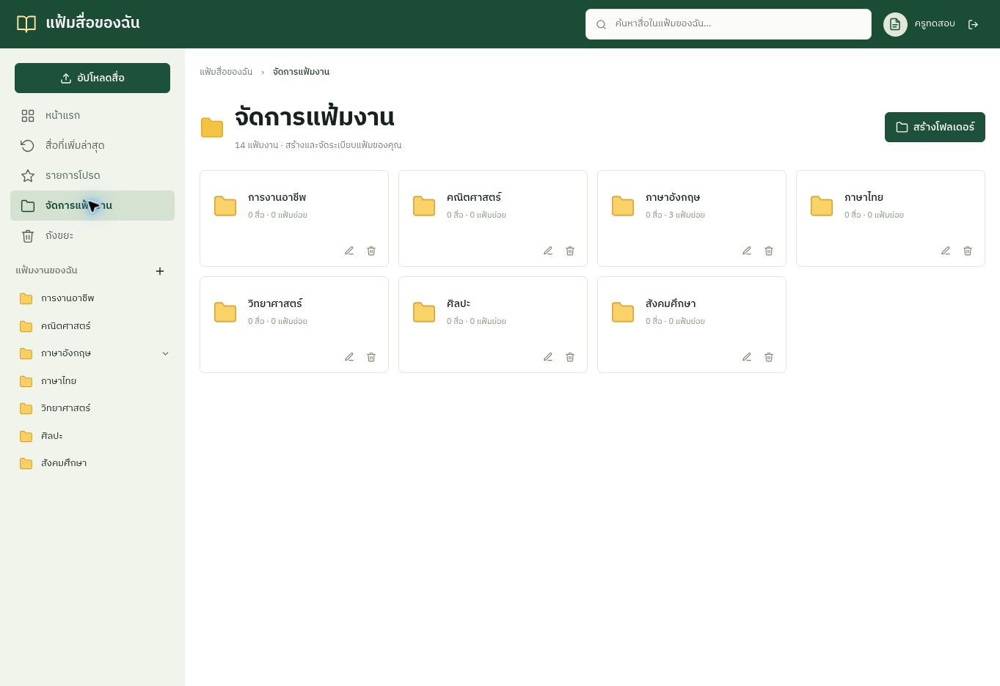
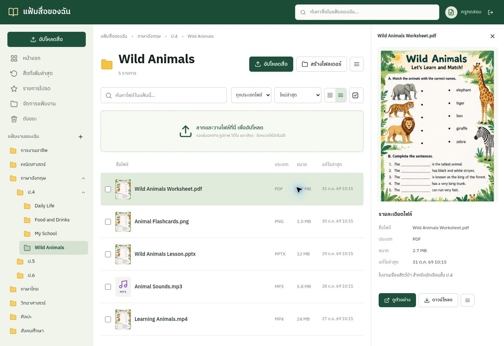

# teaching-media

คลังสื่อการสอนโรงเรียนบ้านป่าเด็ง ใช้บัญชีเดียวกับระบบโรงเรียน และจัดเก็บไฟล์ใน Google Drive ของครู

## แฟ้มงาน

- หน้า **จัดการแฟ้มงาน** ที่ `/#/manage`: สร้างแฟ้ม แก้ชื่อ และเลือกแฟ้มแม่เพื่อย้ายแฟ้ม
- สร้างแฟ้มย่อยตามวิชา–ระดับชั้น–หน่วยการเรียนรู้ได้ไม่เกิน 32 ชั้น
- เมนูแฟ้มด้านซ้ายยุบ/ขยายได้ เปิดแฟ้มผ่าน `/#/folders/<id>` และกด breadcrumb เพื่อย้อนขึ้นได้
- เลือกไฟล์แล้วใช้คำสั่ง **ย้ายแฟ้ม** หรือเลือกหลายไฟล์แล้วย้ายพร้อมกัน
- อัปโหลดหรือเพิ่มลิงก์ขณะเปิดแฟ้ม จะบันทึกเข้าภายในแฟ้มนั้น
- ลบได้เฉพาะแฟ้มว่าง หากมีสื่อหรือแฟ้มย่อย ต้องย้ายออกก่อน
- แฟ้มเป็นส่วนตัวของแต่ละบัญชี มีการตรวจเจ้าของแฟ้มและสื่อทุกคำขอ



## หน้าดูสื่อ

เมนูแฟ้มแบบต้นไม้ รายการพร้อมภาพย่อตรงกลาง และตัวอย่างพร้อมรายละเอียดด้านขวาตามดราฟที่เลือก รองรับค้นหา กรองประเภท จัดเรียง รายการโปรด มุมมองตาราง/รายการ และเมนูมือถือ



## ฐานข้อมูลและการอัปเดต

ใช้ Cloudflare Workers ตาม `wrangler.jsonc` พร้อม D1 และการเชื่อมต่อ Drive เดิม เมื่อมีคำขอ API ครั้งแรก ระบบเพิ่มตาราง `tm_collections` และคอลัมน์ `collection_id` / `favorite` ให้อัตโนมัติ ข้อมูลสื่อเดิมยังอยู่และยังเปิดดูในหน้าแรกได้ สามารถเลือกย้ายเข้าแฟ้มใหม่ภายหลัง

แฟ้มในแอปเป็นโครงสร้างจัดหมวดในฐานข้อมูล ไฟล์จริงยังเก็บในโฟลเดอร์ส่วนตัวของครูใน Drive เดิม การย้ายแฟ้มภายในแอปไม่เปลี่ยนสิทธิ์หรือย้ายไฟล์ไปบัญชีอื่น

## ตรวจสอบ

ใช้ Node.js 22.13 ขึ้นไปสำหรับชุดทดสอบ SQLite ภายในเครื่อง

```sh
npm test
node --check public/app.js
node --check public/viewer.js
node --check src/index.js
node --check src/folders.js
```

ชุดทดสอบตรวจการย้ายฐานข้อมูล การสร้าง/เปลี่ยนชื่อ/ย้าย/ลบแฟ้ม การย้ายสื่อ การป้องกันแฟ้มวนซ้ำ และการกันเข้าถึงข้ามบัญชี ดูผลตรวจหน้าตาและข้อจำกัดใน [design-qa.md](design-qa.md)

ภาพประกอบใช้ข้อมูลทดสอบส่วนตัว ไม่ใช่ข้อมูลผู้ใช้จริง และไม่มีแฟ้มตัวอย่างถูกเพิ่มลงระบบจริง
